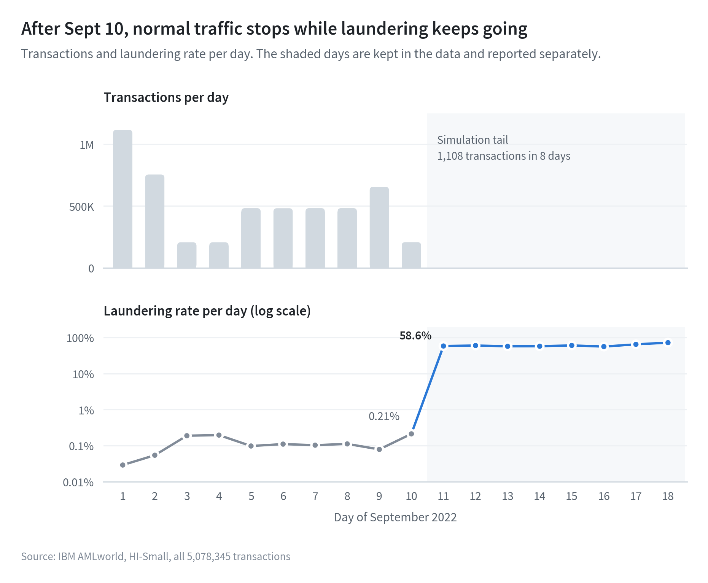
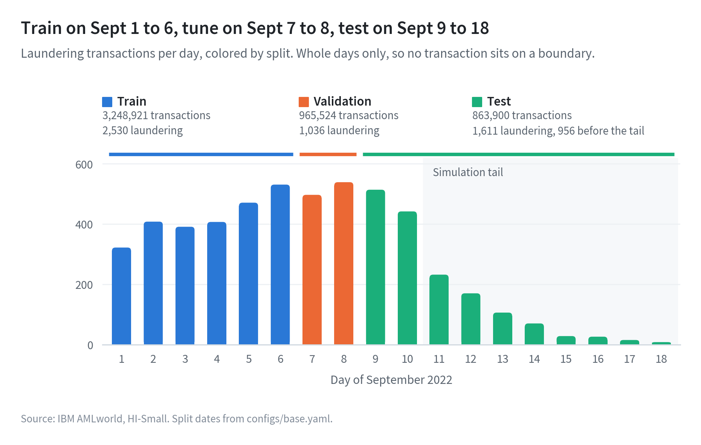
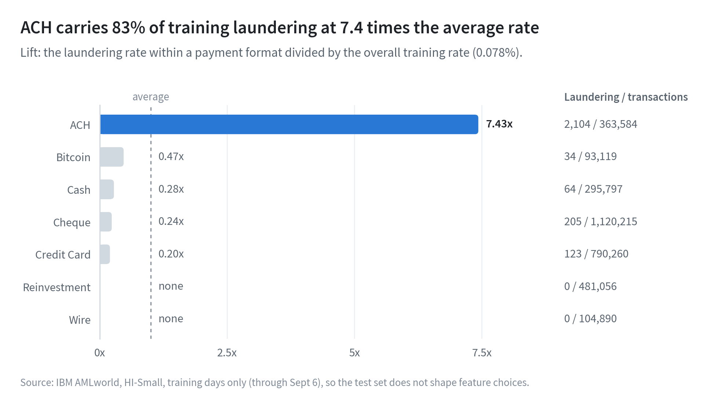
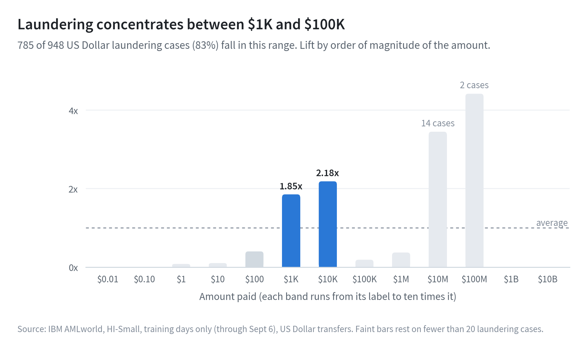

# AML Alert Intelligence

An end-to-end decision system for anti-money-laundering (AML) alert handling: detect suspicious transactions, explain each alert, prioritize investigator workload, and draft Suspicious Activity Report (SAR) narratives.

## Problem

Banks generate far more anti-money-laundering alerts than investigators can review, and the large majority are false positives. Compliance teams spend their limited capacity on noise while real laundering goes unreported. This project builds an end-to-end decision system that combines predictive analytics, mathematical optimization, and AI to close that gap.

- **Predict:** a graph neural network scores each transaction's laundering risk.
- **Optimize:** a mixed-integer program assigns alerts to investigators to maximize expected illicit dollars caught under capacity, skill, and SLA constraints.
- **AI-assisted reporting:** a language model drafts evidence-grounded SAR narratives, and every alert is explained for human review.

## Why it matters

Money laundering finances fraud, trafficking, and other serious crime, and it undermines the integrity of the U.S. financial system. Integrating predictive models with optimization-driven decisions lets financial institutions, including community banks and credit unions with small compliance teams, find more illicit activity with the same resources. Investigators stay accountable for every final decision.

## Approach

| Stage | Method | Output |
|---|---|---|
| Detect | GraphSAGE, GAT, and a temporal GNN variant, benchmarked against XGBoost on engineered features | Laundering risk score per transaction |
| Explain | GNNExplainer and Captum for the GNN, SHAP for XGBoost | Evidence subgraph and key drivers per alert |
| Prioritize | Mixed-integer program for alert assignment, plus decision threshold optimization | Investigator worklists under capacity, skill, and SLA constraints |
| Report | Small open-source language model grounded in structured evidence | Draft SAR narratives for investigator review |

## Success metrics

| Stage | Metrics | Comparison |
|---|---|---|
| Detect | PR-AUC, minority-class F1, recall@k (k = daily alert budget) | GNN vs. XGBoost on the same chronological test split |
| Explain | Fidelity, sparsity | Small explanations that actually drive the prediction |
| Prioritize | Illicit dollars caught, SLA violations, investigator utilization | MILP vs. greedy top-k vs. fixed threshold under the same constraints |
| Report | Fact precision (hard gate), LLM-judge score | Zero untraceable numbers or entities |
| System | Reproducibility | One command runs the full pipeline from a config file |

Numeric targets are not set until baseline results exist. Every test metric is reported twice: on the full test period and without the simulation tail described below.

## Data

[IBM Transactions for Anti-Money Laundering (AMLworld)](https://www.kaggle.com/datasets/ealtman2019/ibm-transactions-for-anti-money-laundering-aml), a synthetic transaction dataset with laundering labels (Altman et al., NeurIPS 2023 Datasets and Benchmarks). This project uses the HI-Small variant. The data contains no real customer information and is not stored in this repository; it is downloaded through the Kaggle API.

| | HI-Small |
|---|---|
| Transactions | 5,078,345 |
| Laundering transactions | 5,177 (0.10%, about 1 in 981) |
| Accounts | 515,088 |
| Period | Sept 1 to Sept 18, 2022 |
| Labeled laundering attempts | 370, in 8 typologies |

The raw CSV is parsed once with an explicit schema and strict parsing, checked for row count and missing values, and stored as Parquet (127 MB instead of 476 MB). Every later step reads the Parquet copy. The full exploration, with every number checked against the data, is in [`notebooks/01_data_exploration.ipynb`](notebooks/01_data_exploration.ipynb).

## Phase 1 findings

### The last eight days are a simulation artifact



Normal traffic follows a weekly cycle until September 10 and then stops. The remaining eight days hold 1,108 transactions, 655 of them laundering, and every one of those 655 belongs to a laundering attempt that was still running when the simulation ended. These days stay in the data. Calendar dates are never used as features, and every test metric is reported with and without them.

### Chronological split



| Split | Days | Transactions | Laundering |
|---|---|---|---|
| Train | Sept 1 to 6 | 3,248,921 | 2,530 |
| Validation | Sept 7 to 8 | 965,524 | 1,036 |
| Test | Sept 9 to 18 | 863,900 | 1,611 (956 before the tail) |

The split is on whole calendar days, so no transaction sits on a boundary. 147 of the 370 laundering attempts span more than one split, so no feature may memorize account identity, and test recall is also reported for attempts that started during the test period.

### Account key

Bank IDs in the transactions carry leading zeros applied inconsistently: 58 banks appear in two written forms, such as 010 and 0010. Without correction, 77 transfers within one bank would look like cross-bank transfers, and no account would match the accounts file. Separately, 8 account numbers are shared by two different banks. Each account is therefore identified by its bank ID without leading zeros plus its account number. All 515,088 accounts in the transactions match the accounts file under this key.

### Payment format



On the training days, ACH carries 83% of all laundering at 7.4 times the average rate, yet only about 1 in 173 ACH transfers is laundering, so the format alone cannot separate cases. Wire and Reinvestment carry no laundering at all, and neither do the 43,097 cross-currency transfers. Among currencies, only Saudi Riyal stands out, at 3.6 times the average rate.

### Amounts



Within US Dollar transfers on the training days, 785 of 948 laundering cases fall between $1,000 and $100,000. The median laundering amount is $4,833, against $971 for normal transfers. Round amounts carry no signal.

### Laundering typologies

| Typology | Attempts | Transactions | Median transactions per attempt |
|---|---|---|---|
| Gather-scatter | 51 | 716 | 14 |
| Scatter-gather | 44 | 626 | 14 |
| Stack | 43 | 466 | 10 |
| Fan-out | 48 | 342 | 7 |
| Fan-in | 40 | 318 | 8 |
| Cycle | 54 | 287 | 4 |
| Bipartite | 49 | 263 | 4 |
| Random | 41 | 191 | 3 |

The named typologies cover 3,209 laundering transactions, 62% of the total. They are used only to evaluate recall per typology, never as model features, since no bank has these labels.

## Repository structure

```
aml-alert-intelligence/
├── configs/
│   └── base.yaml                  # Paths, seed, dataset variant, split dates, Spark settings
├── docs/
│   └── figures/                   # Figures generated by scripts/make_eda_figures.py
├── notebooks/
│   └── 01_data_exploration.ipynb  # Phase 1 exploration with checked results
├── scripts/
│   └── make_eda_figures.py        # Builds the exploration figures from the data
├── src/aml_alert_intelligence/
│   ├── config.py                  # Config loading and path resolution
│   ├── spark.py                   # Spark session from config
│   ├── viz.py                     # Shared figure style
│   └── data/
│       ├── download.py            # Kaggle download, skipping files already present
│       ├── load.py                # Schemas, loaders, account keys, Parquet ingest
│       └── split.py               # Chronological split and tail flag
├── tests/                         # Unit tests (pytest)
├── pyproject.toml
└── requirements.txt
```

## Setup (Google Colab)

```bash
git clone https://github.com/sahandyousefi/aml-alert-intelligence.git
cd aml-alert-intelligence
pip install -e .
pip install -r requirements.txt
```

Restart the Colab session after installing so the package can be imported. Store your Kaggle API token in Colab Secrets as `KAGGLE_API_TOKEN` and `KAGGLE_USERNAME`; never commit credentials. Data and outputs are written to Google Drive under the root set in `configs/base.yaml`.

| Task | Command |
|---|---|
| Download, ingest, and explore the data | Run `notebooks/01_data_exploration.ipynb` from top to bottom |
| Run the unit tests | `python -m pytest -q tests` |
| Rebuild the figures | `python scripts/make_eda_figures.py` |

## Project status

| Phase | Scope | Status |
|---|---|---|
| 0 | Framing and setup | Done |
| 1 | Data pipeline and exploratory analysis (PySpark) | Done |
| 2 | Feature engineering and XGBoost baseline | Next |
| 3 | Graph construction (PyTorch Geometric) | Planned |
| 4 | GNN modeling and benchmark | Planned |
| 5 | Explainability | Planned |
| 6 | Alert triage optimization (MILP) | Planned |
| 7 | SAR narrative generation and evaluation | Planned |
| 8 | End-to-end pipeline and investigator dashboard | Planned |
| 9 | Testing, documentation, and model card | Planned |

## Results

No model results yet. Results will be added as each phase is completed.

## Limitations

- The data is simulated. Some signals are absolute in the simulator, such as payment formats that never carry laundering, and may not hold at a real bank.
- About 38% of laundering belongs to no named typology, so per-typology recall describes only part of the positive cases.
- The data covers 18 days, a much shorter history than a bank would have.
- Amounts come in 15 currencies; converting them to US dollars for the illicit-dollar objective is planned for the optimization phase.

## Responsible use

This system supports investigators. It does not make filing decisions. Every alert comes with an explanation, and every drafted narrative is checked against the underlying evidence before review. A model card documenting limitations and intended use will be added in Phase 9.

## License

MIT
